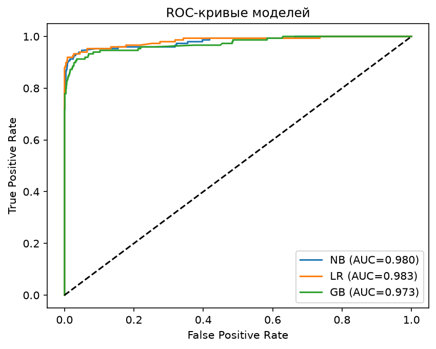
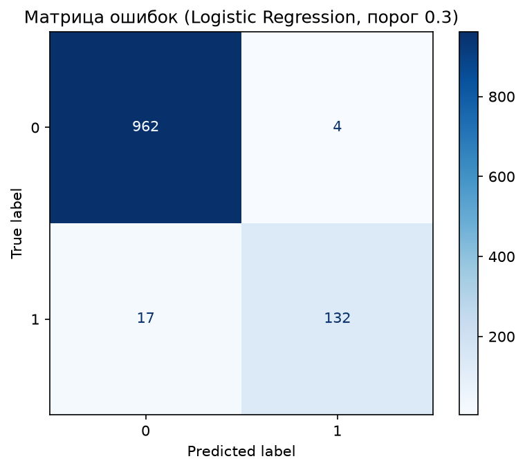

# Детекция спама в текстовых сообщениях

Классификация SMS-сообщений на спам и не-спам с помощью методов машинного обучения. 
Задача актуальна для маркетплейсов и сервисов объявлений: автоматическая фильтрация 
мошеннических сообщений защищает пользователей и снижает нагрузку на модерацию.

## Данные

**SMS Spam Collection** — 5 574 SMS-сообщения на английском языке.

- `ham` — 4 825 сообщений (~87%)
- `spam` — 749 сообщений (~13%)

Классы несбалансированы, поэтому основное внимание уделялось метрикам precision, 
recall, F1 и ROC-AUC, а не accuracy.

Источник: [justmarkham/pycon-2016-tutorial](https://github.com/justmarkham/pycon-2016-tutorial)

## Что сделано

- **EDA:** анализ баланса классов и распределения длины сообщений.
- **Предобработка текста:** приведение к нижнему регистру, удаление пунктуации и стоп-слов.
- **Векторизация:** TF-IDF (`max_features=1000`, `ngram_range=(1, 2)`).
- **Модели:** Multinomial Naive Bayes, Logistic Regression, HistGradientBoosting.
- **Подбор порога классификации** для баланса precision и recall.
- **Подбор гиперпараметров** через GridSearchCV (кросс-валидация, 3 фолда).

## Результаты

| Метрика | Naive Bayes | Logistic Regression | Gradient Boosting | LR (порог 0.3) |
|---------|-------------|---------------------|-------------------|----------------|
| Accuracy | 0.977 | 0.977 | 0.970 | **0.981** |
| Precision | 0.970 | **1.000** | 0.927 | 0.971 |
| Recall | 0.852 | 0.826 | 0.846 | **0.886** |
| F1 | 0.907 | 0.904 | 0.884 | **0.926** |
| ROC-AUC | 0.980 | **0.983** | 0.973 | **0.983** |

**Лучший результат:** Logistic Regression с порогом классификации 0.3 — F1 = **0.926**, 
ROC-AUC = **0.983**, Recall = **0.886**.

**Выводы:**
- Настройка порога дала больший прирост качества, чем подбор гиперпараметров.
- Logistic Regression показала лучший ROC-AUC и самый высокий F1 при пороге 0.3.
- Матрица ошибок показывает всего 4 ложные тревоги (FP) и 17 пропущенных спамов (FN) — 
  хороший баланс для задачи модерации.

## Графики

### ROC-кривые моделей



### Матрица ошибок (Logistic Regression, порог 0.3)



## Стек

- Python 3.14
- pandas, numpy
- scikit-learn
- NLTK
- matplotlib, seaborn
- joblib

## Структура проекта

```
spam-detector/
├── data/
│   └── sms_spam_clean.csv       # очищенный датасет
├── models/
│   ├── lr_model.pkl             # обученная модель Logistic Regression
│   └── tfidf_vectorizer.pkl     # сохранённый TF-IDF векторизатор
├── notebooks/
│   └── 01_spam_detection.ipynb  # основной ноутбук с кодом и анализом
├── reports/
│   └── figures/                 # графики для README
│       ├── roc_curves.png
│       └── confusion_matrix.png
├── nltk_data/                   # локальные стоп-слова
├── .gitignore
└── README.md
```

## Как запустить

1. Установи зависимости:
   ```
   pip install pandas numpy scikit-learn nltk matplotlib seaborn joblib
   ```

2. Открой ноутбук:
   ```
   jupyter notebook notebooks/01_spam_detection.ipynb
   ```

3. Ноутбук выполняется сверху вниз — от загрузки данных до сохранения модели.

## Как использовать обученную модель

```python
import joblib
from nltk.corpus import stopwords
import re

# Загружаем модель и векторизатор
model = joblib.load('models/lr_model.pkl')
vectorizer = joblib.load('models/tfidf_vectorizer.pkl')

# Функция очистки текста (та же, что в ноутбуке)
stop_words = set(stopwords.words('english'))

def clean_text(text):
    text = text.lower()
    text = re.sub(r'[^a-zA-Z\s]', '', text)
    words = [w for w in text.split() if w not in stop_words]
    return ' '.join(words)

# Применение к новому сообщению
message = "Free entry in 2 a wkly comp to win FA Cup final tkts"
cleaned = clean_text(message)
vec = vectorizer.transform([cleaned])
pred = model.predict(vec)[0]
proba = model.predict_proba(vec)[0, 1]

print(f"Предсказание: {'spam' if pred == 1 else 'ham'}")
print(f"Вероятность спама: {proba:.3f}")
```

## Автор

**Мадина Тагаева**
- GitHub: [github.com/tagmrr](https://github.com/tagmrr)
- Telegram: @tagmrr